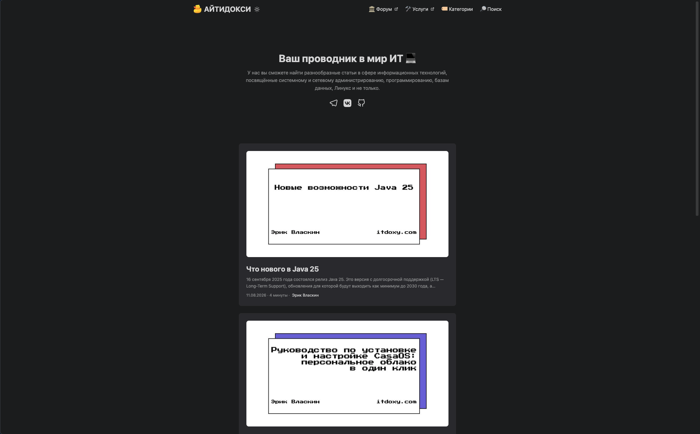

# АЙТИДОКСИ / ITDOXY

[](https://github.com/ITDOXY/itdoxy.com/actions/workflows/main.yml)

Русскоязычный технический блог о программировании, Linux, системном и сетевом администрировании и базах данных. В этом репозитории хранятся статьи в Markdown и исходники сайта на Hugo и PaperMod.

[Читать блог на ITDOXY.com](https://itdoxy.com/)



## Быстрый старт

Установите [Git](https://git-scm.com/) и [Hugo Extended](https://gohugo.io/installation/). В GitHub Actions используется Hugo Extended `0.168.0`.

```bash
git clone --recurse-submodules https://github.com/ITDOXY/itdoxy.com.git
cd itdoxy.com
hugo server -D
```

Откройте [http://localhost:1313/](http://localhost:1313/). Флаг `-D` включает черновики в локальный предпросмотр.

Если репозиторий уже клонирован, перед запуском сервера загрузите тему из корня проекта.

```bash
git submodule update --init --recursive
```

## Структура проекта

- [`content/`](content/) — статьи в `posts/`, отдельные страницы, категории и теги.
- [`archetypes/`](archetypes/) — шаблоны нового контента.
- [`layouts/`](layouts/) — шаблоны и частичные шаблоны сайта, в том числе переопределения темы.
- [`static/`](static/) — изображения, CSS и другие файлы, которые Hugo копирует при сборке.
- `themes/PaperMod/` — тема PaperMod, подключённая как Git-подмодуль.
- [`hugo.yml`](hugo.yml) — конфигурация сайта.

## Как добавить статью

Замените `YYYY-MM-DD` датой, а `topic` — коротким названием темы.

```bash
hugo new content posts/YYYY-MM-DD-topic.md
```

Hugo создаст файл в `content/posts/` по [шаблону статьи](archetypes/default.md). Заполните метаданные в начале файла (front matter).

```toml
+++
title = "Как читать журналы Linux"
slug = "linux-logs"
date = 2026-08-16T12:00:00+03:00
categories = ["Linux"]
author = "Ваше имя"
draft = true
+++
```

Для статьи с локальной обложкой используйте каталог `content/posts/YYYY-MM-DD-topic/` с файлами `index.md` и `cover.jpg`. Добавьте в конец front matter, перед закрывающим `+++`, секцию `[cover]`.

```toml
[cover]
image = "cover.jpg"
relative = true
```

Front matter можно заполнить вручную в YAML, как в большинстве статей репозитория. Поместите блок YAML между двумя строками `---` в самом начале файла. Если файл создан командой `hugo new content`, замените весь блок TOML вместе с разделителями `+++`.

Проверьте статью через `hugo server -D`. Перед публикацией задайте полю `draft` значение `false` и проверьте дату. Статьи с будущей датой не входят в обычную сборку. Сохраняйте `slug` опубликованных статей, чтобы их адреса оставались прежними.

## Сборка и публикация

```bash
hugo --minify
```

Готовые файлы появятся в `public/`. Не добавляйте этот каталог в Git.

После пуша в `main` или ручного запуска [workflow сборки и публикации](.github/workflows/main.yml) GitHub Actions собирает сайт и публикует его в Yandex Object Storage.

## Как предложить изменения

- Чтобы исправить статью, откройте её на сайте и нажмите «Предложить изменение». В GitHub откройте файл на редактирование и создайте пул-реквест в `main`.
- Перед отправкой новой статьи или изменений сайта проверьте их локально и откройте пул-реквест в `main`.
- О технической проблеме можно сообщить через [GitHub Issues](https://github.com/ITDOXY/itdoxy.com/issues).

## AI-редакция

- [Руководство для авторов](docs/ai-editorial.md) — работа с источниками, подготовка и обновление статей, редакционная проверка.
- [Статус внедрения](docs/plans/ai-editorial-progress.md) — что уже настроено и на каком этапе пилот.

## Контакты

- [Telegram-канал ITDOXY](https://t.me/s/ITDOXY)
- [Форум ITDOXY в Telegram](https://t.me/ITDOXY_FORUM)
- [Занятия и консультации](https://services.tochkaplace.com)

Тексты статей защищены авторским правом.
